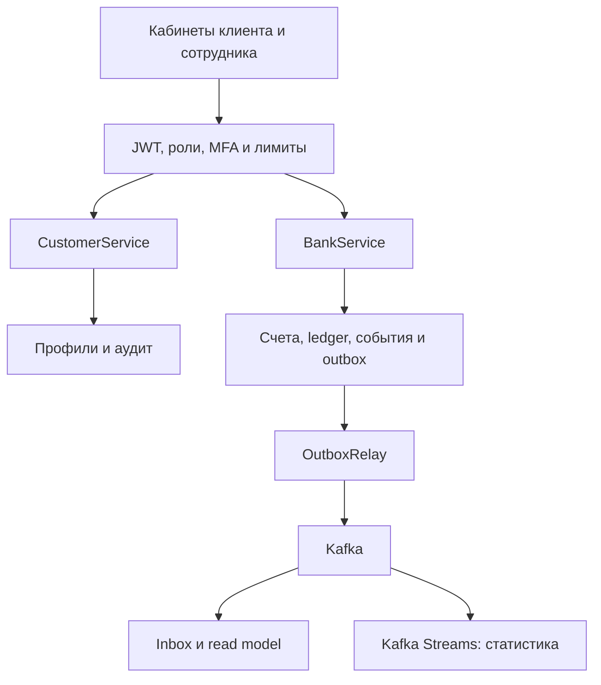
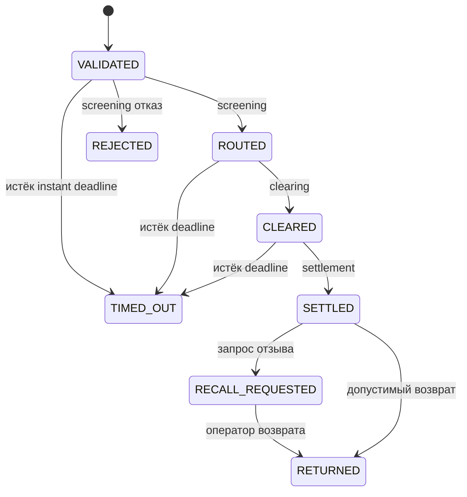

# Как устроен учебный банк

Это модульное Spring Boot приложение, а не набор независимо развёртываемых микросервисов. Такой выбор позволяет сначала понять банковские инварианты: деньги, блокировки, состояние платежа и согласованность событий. Модули можно разделить позднее, сохранив контракты и явные границы транзакций.

## Командная транзакция

Деньги представлены `BigDecimal` с двумя десятичными знаками. `balance` — учётный остаток, `held` — резерв, доступно `balance − held`. Инициация проверяет клиента, KYC, приостановку, схему, владельца счёта, имя получателя и доступную сумму. Она резервирует деньги, но не переводит их окончательно.

При settlement списание, зачисление, две противоположные проводки, смена состояния, запись истории и outbox совершаются в одной транзакции. Ошибка откатывает всё. Сумма проводок по booking равна нулю. Лабораторное пополнение имеет отдельную встречную treasury-проводку; это не входящий межбанковский расчёт.

Профили блокируются в порядке subject, счета — в порядке ID. Такой порядок уменьшает риск deadlock при одновременных встречных переводах. `SELECT FOR UPDATE` защищает остаток от параллельного расходования. Для контактов используется optimistic version: устаревшее обновление получает 409 вместо тихого затирания нового значения.

`Idempotency-Key` привязан к инициатору и отпечатку запроса. Точная повторная команда возвращает прежний платёж; другой запрос с тем же ключом конфликтует. Ключ нужен при таймауте HTTP: клиент не знает, успел ли сервер выполнить команду. Финальное состояние проверяют по ID платежа, а не создают новый перевод.

## Состояния платежа

В истории также есть промежуточные события RECEIVED и SCREENED. Точный список переходов задаёт `BankService.transition`, а диаграмма показывает основные ветви. Отказ или timeout освобождает резерв. Возврат создаёт обратные проводки и требует достаточного доступного остатка получателя. Recall после settlement — запрос, а не автоматическая отмена уже завершённого расчёта.

`PaymentWorker` включается только явным флагом `BANK_AUTO_CLEARING_ENABLED=true`. Он моделирует локальный успешный цикл; scheduler истечения instant deadlines работает отдельно. Реальный платежный адаптер должен обрабатывать внешний результат, неизвестный outcome, повторы и статусы схемы.

## События и CQRS

Outbox фиксирует намерение отправить событие в той же транзакции, что и деньги. Relay публикует и только затем отмечает доставку. Возможен повтор после сбоя, поэтому гарантия — at least once. Inbox хранит event ID, потребитель блокирует платёж и обновляет проекцию только при более новом sequence. Читать удобно из JPA read model, писать — через явные SQL-команды и блокировки.

Kafka key — payment ID: события одного платежа попадают в одну partition. Статистика Streams использует последнее состояние платежа и не считает старый повтор новым платежом. Опционально включена обработка exactly-once-v2; она не делает HTTP/ledger/внешние платежные сети одной атомарной транзакцией.

Journal здесь не полноценный event sourcing: основное состояние хранится в SQL, события дают аудит и проекции. Saga реализована как управляемый жизненный цикл и компенсация возвратом внутри одной системы. Межсервисный saga orchestrator не реализован.

Schema Registry опционально регистрирует JSON schema. Payload — обычный JSON с schema ID в Kafka header; это не стандартный Confluent wire format. Circuit breaker защищает учебную границу clearing; настоящего внешнего сетевого сервиса нет.

## Файлы для чтения

Начать с `domain/BankService.java`, затем миграции V1/V2, `customers/CustomerService.java`, `events/OutboxRelay.java`, `events/EventConsumer.java`, `events/PaymentTopology.java`, `security/SecurityConfig.java`, `iso/IsoService.java`. Tests показывают как нормальный путь, так и отказные сценарии.
