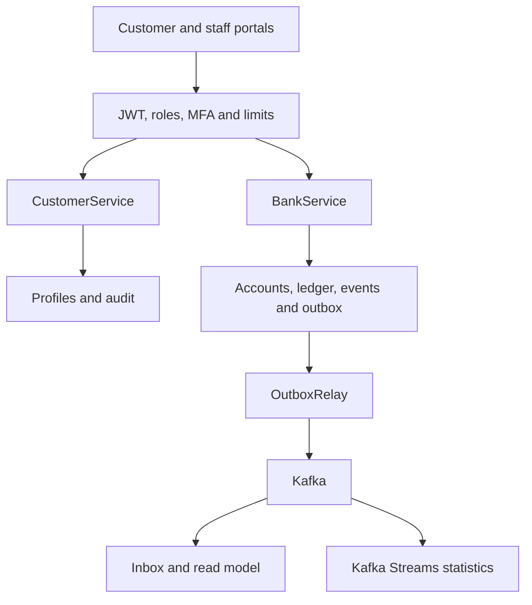
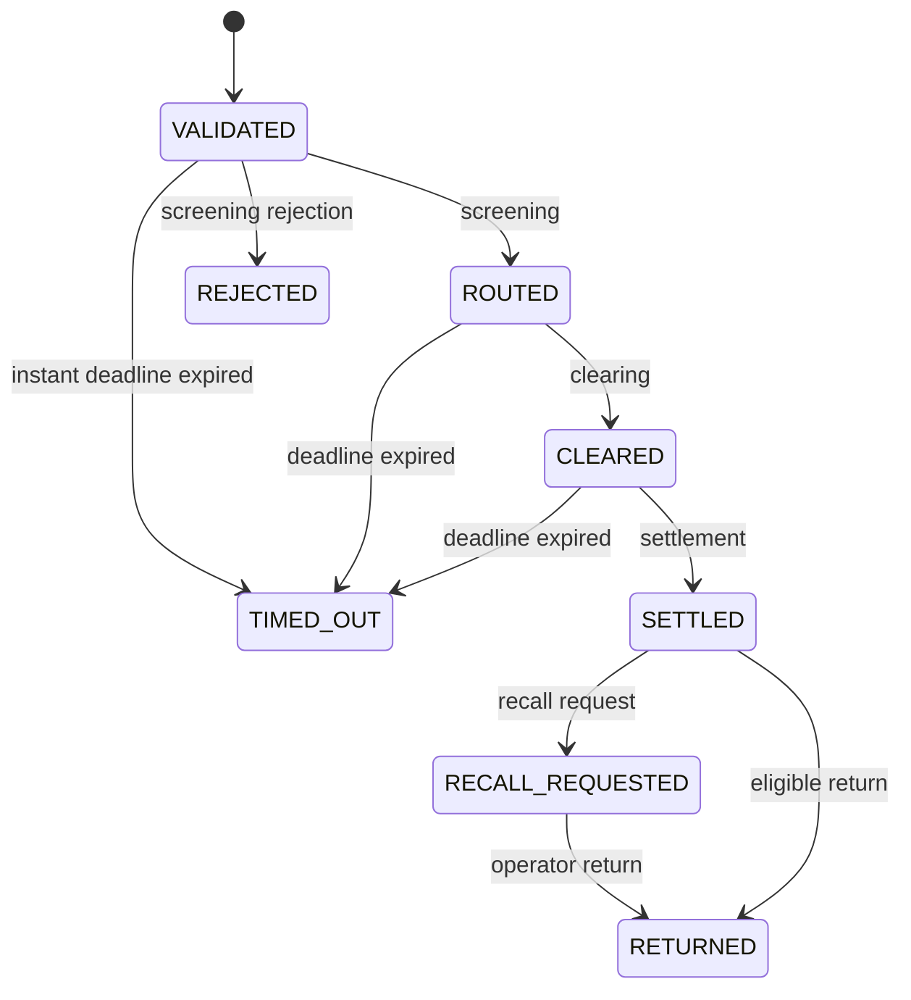

# How the learning bank works

This is a modular Spring Boot application, not independently deployed microservices. It first makes the banking invariants visible: money, locks, payment state and event consistency. Modules can be separated later while preserving contracts and explicit transaction boundaries.

## Command transaction

Money uses `BigDecimal` with two decimal places. `balance` is the booked balance, `held` is the reservation, and available funds are `balance - held`. Initiation checks the customer, KYC, suspension, scheme, account ownership, payee name and available amount. It reserves funds without completing a transfer.

At settlement, the debit, credit, two opposing postings, state change, history and outbox are committed in one transaction. Any failure rolls everything back. Postings for one booking sum to zero. Lab funding has an opposing treasury posting; it is not an incoming interbank settlement.

Profiles are locked in subject order and accounts in ID order. This reduces deadlock risk for concurrent transfers in opposite directions. `SELECT FOR UPDATE` protects balances against concurrent spending. Contact updates use an optimistic version: stale changes return 409 instead of overwriting a newer value.

`Idempotency-Key` is bound to the actor and request fingerprint. An identical retry returns the original payment; another payload with the same key conflicts. After an HTTP timeout the client may not know whether the command succeeded. It should check the payment ID rather than create another transfer.

## Payment states

History also contains RECEIVED and SCREENED events. `BankService.transition` defines the exact transitions; this diagram shows the main branches. Rejection or timeout releases the reservation. A normal transfer return creates opposing postings and requires sufficient available recipient funds. SDD refunds have separate bank-funded credit and recovery rules; see [SDD-REFUNDS.md](SDD-REFUNDS.md). A recall after settlement is a request, not automatic cancellation of completed settlement.

`PaymentWorker` requires explicit `BANK_AUTO_CLEARING_ENABLED=true`. It simulates a successful local lifecycle; instant deadline expiry has a separate scheduler. A real adapter must handle external outcomes, unknown results, retries and scheme statuses.

## Events and CQRS

The outbox records publication intent in the same transaction as the money movement. The relay publishes first and marks delivery afterwards. A crash can cause a retry, so delivery is at least once. The inbox stores event IDs; the consumer locks the payment and updates its projection only for a newer sequence. Reads use a JPA read model, while commands use explicit SQL and locks.

Kafka keys are payment IDs, keeping one payment's events in one partition. Streams statistics use the latest payment state and do not treat an old retry as a new payment. Optional exactly-once-v2 processing does not make HTTP, the ledger and external payment networks one atomic transaction.

The journal is not full event sourcing: primary state lives in SQL and events support audit and projections. The saga is a managed lifecycle with return compensation inside one system. A distributed saga orchestrator is not implemented.

Optional Schema Registry integration registers a JSON schema. Payloads are regular JSON with a schema ID in a Kafka header, not the standard Confluent wire format. The circuit breaker protects a simulated clearing boundary; no real external clearing service is connected.

## Reading order

Start with `domain/BankService.java`, migrations V1-V5, `customers/CustomerService.java`, `events/OutboxRelay.java`, `events/EventConsumer.java`, `events/PaymentTopology.java`, `security/SecurityConfig.java` and `iso/IsoService.java`. Tests illustrate successful and failure scenarios.
